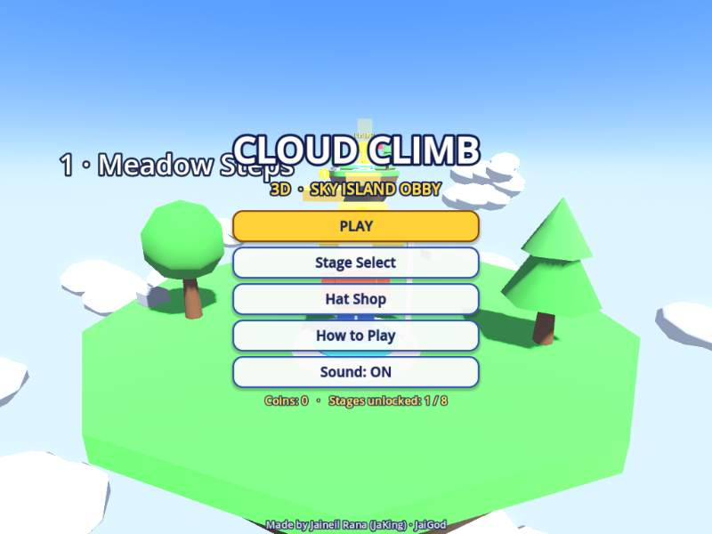
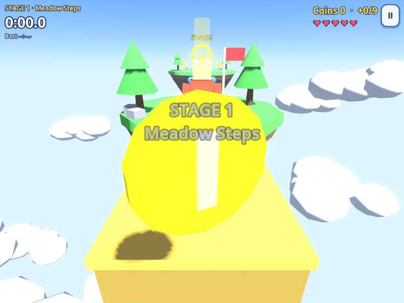
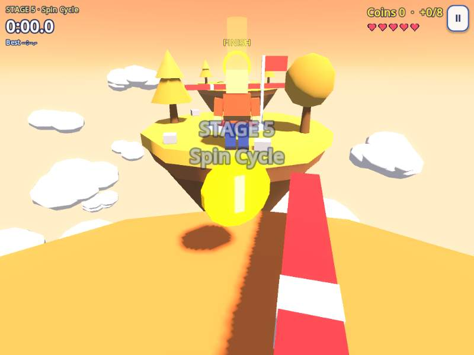
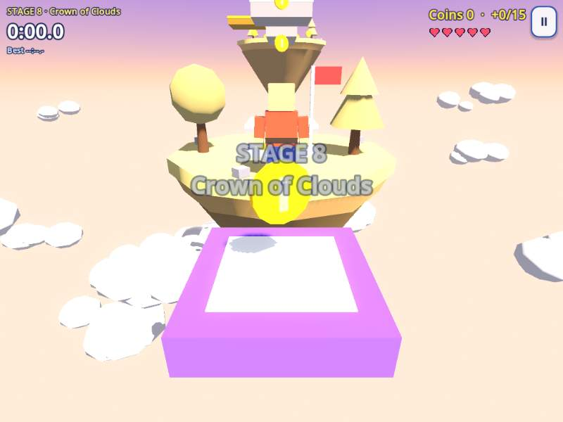

<div align="center">

# ☁️ Cloud Climb 3D

### A low-poly 3D sky-island obby made with Godot 4

**Climb 8 floating islands · race the clock · collect coins · unlock hats**

[](https://jaigod.github.io/cloud-climb-3d/play/)

[](https://jaigod.github.io/cloud-climb-3d/)
[](https://godotengine.org)
[](https://github.com/JaiGod/cloud-climb-3d/actions/workflows/deploy.yml)
[](LICENSE)
[](https://github.com/JaiGod)

</div>

---

## 📸 Screenshots

| Title screen | Stage 1 · Meadow Steps |
|:---:|:---:|
|  |  |
| **Stage 5 · Spin Cycle** | **Stage 8 · Crown of Clouds** |
|  |  |

Screenshots were captured from the live web build. Add `?shot=N` to the play URL (for example [`/play/?shot=5`](https://jaigod.github.io/cloud-climb-3d/play/?shot=5)) to jump straight to stage N.

> All art is built from code at runtime: low-poly meshes, materials, sky and particles. No imported models, textures or audio files.

---

## 🎮 Play

| | Link |
|---|---|
| ▶ **Play the game** | **https://jaigod.github.io/cloud-climb-3d/play/** |
| 🏠 Landing page | https://jaigod.github.io/cloud-climb-3d/ |
| 🛠️ Source code | [`scripts/`](scripts) · [`main.tscn`](main.tscn) · [`web/`](web) |
| ⚙️ CI / deploy | [`.github/workflows/deploy.yml`](.github/workflows/deploy.yml) · [Actions runs](https://github.com/JaiGod/cloud-climb-3d/actions) |

It runs on desktop browsers and phones. No install needed.

---

## ✨ Features

- **8 handcrafted sky islands**, each harder than the last:
  1. Meadow Steps · 2. Breezy Bridges · 3. Blink Blocks · 4. Fan Falls · 5. Spin Cycle · 6. Lava Lagoon · 7. Storm Gauntlet · 8. Crown of Clouds
- **Checkpoint flags** save your spot and refill your hearts
- **Obby hazards:** moving platforms, purple blocks that vanish when you touch them, pink blocks that blink on a beat, fans that lift you, spinning knock-back bars, lava and neon-red kill bricks
- **5 hearts per run.** Fall off or touch a hazard and you lose one. Lose them all and the stage restarts.
- **Speedrun timer** with a **best time per stage**. Completing a stage unlocks the next.
- **Coins** on every island to spend in the **Hat Shop**: Sky Cap, Party Cone, Top Hat, Propeller, Viking Helm, Royal Crown and Halo
- **Juice:** dust puffs, coin bursts, finish-line confetti, screen shake, squash-and-stretch and eased UI tweens
- **Procedural audio:** every sound effect and the music loop are synthesised in code at startup, with a sound on/off toggle
- **Progress is saved** (best times, coins, unlocked stages, chosen hat) in `user://`, which is IndexedDB on the web
- **Pause menu** with Resume, Respawn at checkpoint, Restart stage, Sound and Main menu
- **Responsive UI** for landscape desktops and portrait phones (390 px wide)

---

## 🕹️ Controls

| Action | Keyboard / mouse | Phone / tablet |
|---|---|---|
| Move | **WASD** / **Arrow keys** | Left-thumb floating joystick |
| Jump (hold for higher) | **Space** | Green **JUMP** button |
| Look around | Click the game, then move the mouse · **Q / E** to turn | Drag on the right side of the screen |
| Zoom camera | Mouse wheel | — |
| Respawn at checkpoint | **R** | Pause → Respawn |
| Pause | **Esc** / **P** | ⏸ button |

---

## 🧰 Tech stack

- **Godot 4.3**, GDScript, **Compatibility (OpenGL / WebGL 2)** renderer so it runs on almost any device
- **Web export** with threads off (`variant/thread_support=false`), so it works on GitHub Pages without COOP/COEP headers
- **GitHub Actions** using the `barichello/godot-ci:4.3` container: import → headless smoke test → web export → GitHub Pages
- A hand-written HTML/CSS **landing page** (`web/index.html`) with no frameworks and no CDNs

## 📁 Project structure

```
cloud-climb-3d/
├── project.godot          # Godot 4.3 project (Compatibility renderer)
├── main.tscn              # Single root scene; everything else is built in code
├── export_presets.cfg     # "Web" preset (no threads)
├── icon.svg
├── scripts/
│   ├── main.gd            # Game states, UI/HUD, timer, saves, hat shop, smoke test
│   ├── world.gd           # Builds all 8 islands: platforms, hazards, coins, checkpoints
│   ├── player.gd          # Blocky avatar, character controller, camera rig, hats
│   ├── touch.gd           # On-screen joystick, jump button and drag-to-look
│   └── sfx.gd             # Procedural SFX + music synthesised into AudioStreamWAV
├── web/index.html         # Landing page → deployed to the site root
├── tests/                 # Jump-metrics helper scene used while tuning the stages
├── docs/screenshots/      # README images
└── .github/workflows/deploy.yml
```

## 🧪 Run locally

1. Install [Godot 4.3](https://godotengine.org/download) (standard build).
2. Clone the repo: `git clone https://github.com/JaiGod/cloud-climb-3d.git`
3. Open `project.godot` in Godot and press **F5**.

Headless smoke test (plays through all 8 stages: coin pickup, fall damage, finish ring):

```bash
godot --headless --import
godot --headless -- --smoke        # prints "SMOKE PASS"
```

Web build:

```bash
godot --headless --export-release "Web" build/play/index.html
cp web/index.html build/index.html
cd build && python3 -m http.server 8000   # open http://localhost:8000/play/
```

---

## 📓 Development log

- **Concept.** I wanted a Roblox-style obby with its own look: blocky characters, candy-coloured low-poly islands and a cloud sea. Each island teaches one new mechanic before mixing them, ending with the "Crown of Clouds" final gauntlet.
- **Everything from code.** To keep the project 100% original and tiny (the game pack is about 90 KB), every mesh, material, particle and sound is generated at runtime. `world.gd` has a small builder API (`plat()`, `mover()`, `blinker()`, `fan_up()`, `spinner()`, `lava()`, `checkpoint()`, …) so each stage is a short function.
- **Renderer choice.** I used the Compatibility renderer because Forward+ doesn't run in browsers, and Compatibility runs on school Chromebooks and phones.
- **Jump tuning.** I wrote `tests/metrics.tscn` to measure jump apex and distance, then spaced every gap to stay inside those numbers with a safety margin. Coyote time and jump buffering make the platforming feel fair.
- **Moving platforms.** Movers are `AnimatableBody3D`s, so the `CharacterBody3D` player rides them instead of sliding off. Vanishing blocks flash and pulse for about 0.65 s before they disappear, then come back 2 s later, so a mistake never soft-locks a run.
- **Phones.** I added a floating joystick, a jump button and drag-to-look, plus a portrait camera mode (wider FOV, fixed-width aspect). The UI scale switches between 540p and 648p depending on the screen's short side.
- **Web without headers.** GitHub Pages can't send COOP/COEP headers, so the export has threads disabled, and audio uses Godot's no-threads audio worklet.
- **CI as the safety net.** Before exporting, the workflow runs `--smoke`, which teleports through all 8 stages and checks that coins, hearts and the finish ring work. A broken level fails the build instead of shipping.
- **Polish pass (Nov 5, 2026).** Tightened the title menu so it fits 540 px-tall screens, and moved the controls hint to the bottom of the screen so it no longer overlaps the stage banner.
- **Beta tested on the live site ✅ (2026-11-05)**: `/play/` boots past the loading bar, the title menu works, PLAY starts Stage 1, movement, jump and the pause menu respond, and the console shows no errors.

---

## 🌐 More JaiGod games

Browse every game at **[github.com/JaiGod](https://github.com/JaiGod)**. Related projects:

- [Orbit Sling](https://github.com/JaiGod/orbit-sling) · [play](https://jaigod.github.io/orbit-sling/)
- [Neon Drift 3D](https://github.com/JaiGod/neon-drift-3d) · [play](https://jaigod.github.io/neon-drift-3d/)
- [Bulwark TDS](https://github.com/JaiGod/bulwark-tds) · [play](https://jaigod.github.io/bulwark-tds/)
- [Harvest Hollow](https://github.com/JaiGod/harvest-hollow) · [play](https://jaigod.github.io/harvest-hollow/)
- [Ember Crypt](https://github.com/JaiGod/ember-crypt) · [play](https://jaigod.github.io/ember-crypt/)
- [The Hollow Between](https://github.com/JaiGod/the-hollow-between) · [play](https://jaigod.github.io/the-hollow-between/)
- [Starfall Chronicle](https://github.com/JaiGod/starfall-chronicle) · [play](https://jaigod.github.io/starfall-chronicle/)
- [Moonfarm](https://github.com/JaiGod/moonfarm) · [play](https://jaigod.github.io/moonfarm/)
- [Voltline](https://github.com/JaiGod/voltline) · [play](https://jaigod.github.io/voltline/)

## 📄 License

[MIT](LICENSE) © 2026 Jaineil Rana

---

<div align="center">

Made by Jaineil Rana (JaKing) · part of [JaiGod](https://github.com/JaiGod)

</div>
